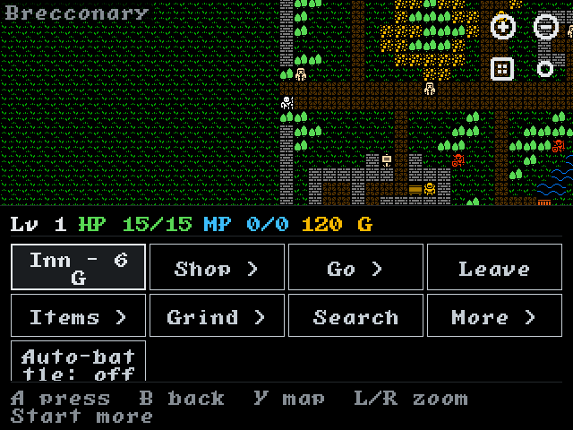

# drgnwrrr



Dragon Warrior's rules without the walking, dialogue and drama. You say where to go and how much
risk you'll take; the game walks the route tile by tile with the original's encounter rules and
stops for battles and decisions.

## Building

The maps and NPC tables come from a Dragon Warrior (U) ROM, which isn't included. `zig build`
runs `tools/romextract`, which decodes them with the ROM-checked `dw.Maps.fromBank0` and writes
them out as Zig source (`romdata.zig` in the build cache, one hex digit per tile). The game is
compiled with that data and never reads the ROM itself.

```sh
zig build                           # reads ./dragon_warrior.nes
zig build -Drom=path/to/rom.nes     # or another path
```

## Playing the CLI game

```sh
zig build run                       # drgnwrrr-cli: saves to ./drgnwrrr.sav
zig build run -- --new --seed 42    # new game, reproducible run
zig build run -- --no-color         # also honours NO_COLOR and TERM=dumb
zig build run -- --assist           # the remakes' conveniences: auto stairs and chests, no asking on safe routes
```

On a terminal, input goes through [isocline](https://github.com/daanx/isocline) (MIT): up/down
history saved in `$XDG_DATA_HOME/drgnwrrr/history`, ctrl+r search, and Tab completion that knows
the command (`go bre<Tab>`, `cast he<Tab>`, `use fa<Tab>`). The status prompt turns red when HP is
low, at the same point the NES status window does (HP <= max/4 + 1). Piped input is read plainly,
so scripts and tests work without a terminal. Only `drgnwrrr-cli` links libc (for isocline); the
engine module doesn't. `zig build` fetches isocline into `zig-pkg/` (pinned in `build.zig.zon`).

```
go brecconary safe        plan a route (steps, expected fights, HP loss, death risk), then walk it
go 60 30 fast stop=40     any overworld tile; stop if a fight leaves you under 40% HP
grind 10 auto             find the best spot nearby and fight up to 10 battles
danger                    what one fight costs you in each zone, right now
checklist · go 3 · take · search · talk · open
status · items · places · look · herb · cast heal · use 2 · auto on|off
inn · shop · buy 2 · sell 1 · save · mp · leave             (in towns)
f · r · h · c hurt        (in battle; Enter = fight)
```

## Playing in a browser

```sh
zig build -Dtarget=wasm32-freestanding run   # build zig-out/web and serve it on http://localhost:8080
zig build serve -- 9000                      # the same, on another port
zig build web                                # just build zig-out/web (static files; host them anywhere)
```

The engine is compiled to a freestanding wasm module (`src/web/main.zig`, no libc) driving a
`Session` (`src/session.zig`): the CLI's commands and log, without blocking for input. Everything
runs in the browser; the king's saves go to localStorage in the same 8 KB format as `drgnwrrr.sav`.
`tools/serve` is a small static server written with Zig's std library.

The CLI and the web build are frontends over the same `Session` (`src/session.zig`): it takes the
command lines, writes the log, and holds a pending prompt instead of blocking for input.

The engine (`src/`; the CLI is `src/cli/`) imports `tools/romcheck/reference.zig` as the `dw` module, so every formula
it runs is the ROM-checked port. `src/travel.zig` is the risk-weighted route planner;
`src/battle.zig` drives a battle in the ROM's roll order.

The whole story can be played: `checklist` lists what the game only tells you through dialogue
(where the Token is buried, what the shrines want, where Gwaelin waits) and `go <number>` walks
there. Every map can be walked: towns, castles, shrines and caves. Doors take a Magic Key, stationary NPCs
block their tiles, and TAKE, SEARCH and TALK follow the ROM (chest table, search spots, the
shrines, the princess, the Dragonlord's offer and both of his forms).

Town services (inns, every weapon, tool and key shop, Fairy Water, Tantegel's MP restorer) come
from the ROM's NPC tables, and walking spends the ROM's 2 RNG calls per tile; both are checked by
`zig build romcheck`. Not modelled: moving NPCs (they don't block you), darkness in caves (light has no effect on
the rules), and dialogue beyond what changes the game.

## Playing on Android

```sh
zig build -Dandroid                     # zig-out/bin/drgnwrrr.apk (arm64-v8a)
zig build -Dandroid run                 # install it with adb and start it
zig build -Dandroid -Dandroid_abis      # every ABI, for emulators and older phones
```

This is the native SDL game (`src/sdl/`), built as `libmain.so` behind SDL's Java glue. It
needs the Android SDK and NDK; the flake's devShell provides them and sets `ANDROID_HOME`. The
APK is signed with a throwaway debug key, which is fine for `adb install` but not for a store.
The layout follows the screen: the map goes beside the panel in landscape and above it in
portrait. The name uses the letter grid, and tapping the command line brings up the keyboard.
Back closes menus, and pinching zooms the map.

## ROM check

`tools/romcheck` runs the original game's routines in a small 6502 interpreter and compares
them against the reference ports in `tools/romcheck/reference.zig`. It compares results and the
RNG state afterwards. It needs a Dragon Warrior (U) ROM, which isn't included:

```sh
zig build romcheck                      # sampled, a few seconds; reads ./dragon_warrior.nes
zig build romcheck -- --full            # exhaustive, ~140M cases, a few minutes
zig build romcheck -Drom=path/to/rom.nes
```

Without the ROM, it prints a notice and exits successfully.

`reference.zig` is generated from the formula reference page in `docs/reference/`. Edit
`docs/reference/template.html` and run `node docs/reference/build.mjs` (see its README).

## Acknowledgements

- Uses [1-Bit Pack](https://kenney.nl/assets/1-bit-pack) and [Input Prompts
Pixel 1-Bit](https://kenney.nl/assets/input-prompts-pixel-1-bit) from Kenney.
- Uses [anvil font](https://damieng.com/typography/zx-origins/anvil/) from
DamienG's ZX Origins font collection.

## References

- Detailed [analysis of
formulas](https://gamefaqs.gamespot.com/nes/563408-dragon-warrior/faqs/61640)
- [Dragon Warrior (NES) SRAM
Document](https://games.technoplaza.net/dwsrame/sram-doc.txt)
